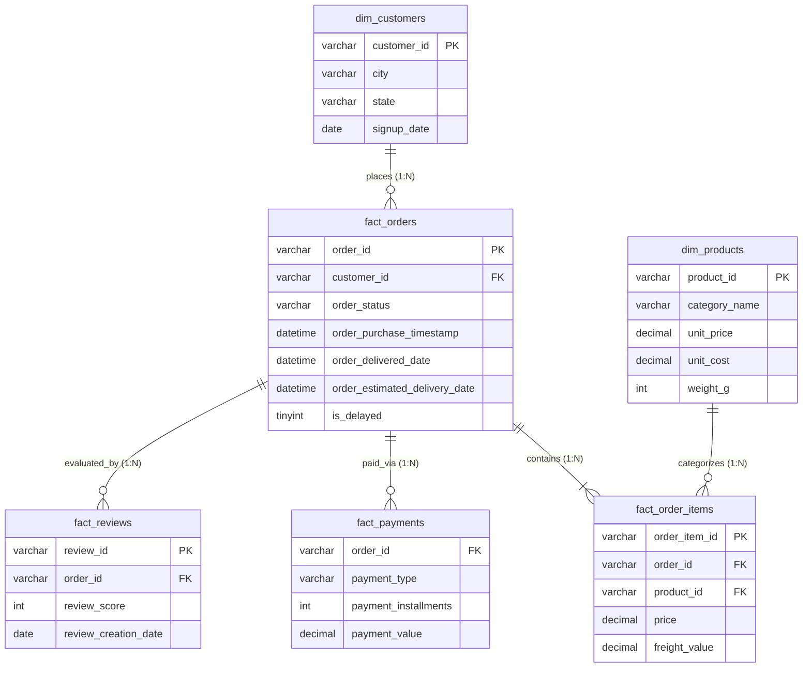
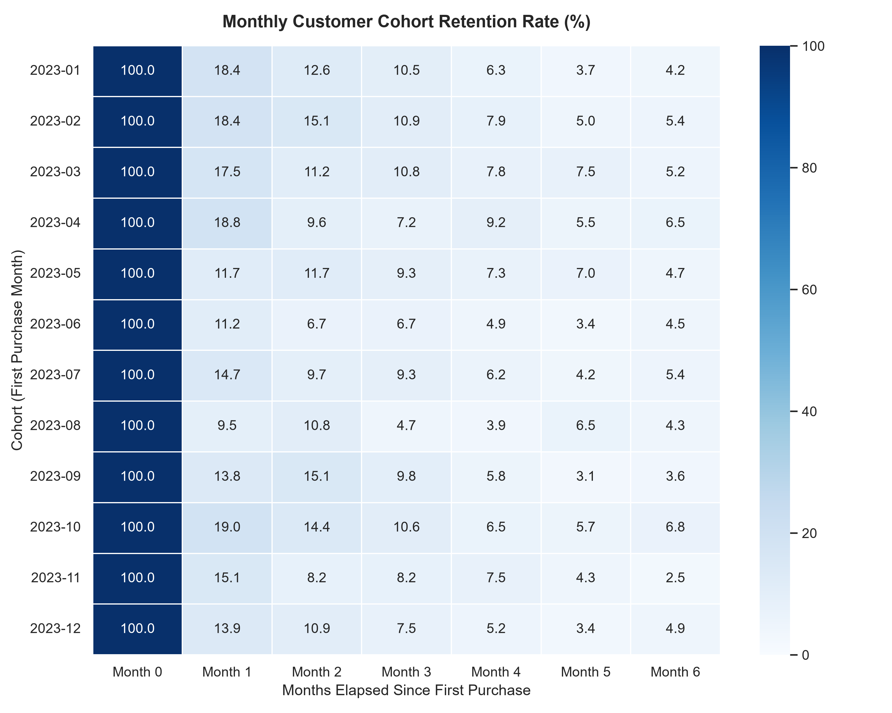
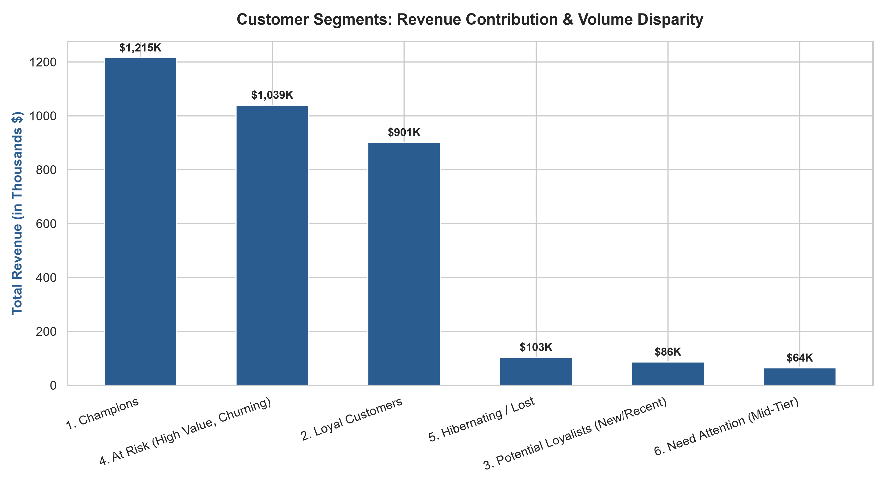
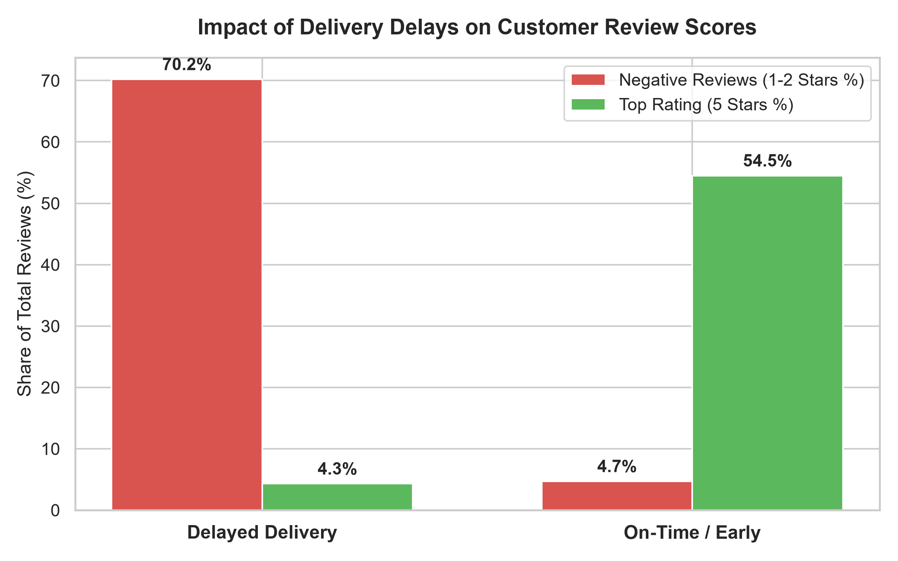
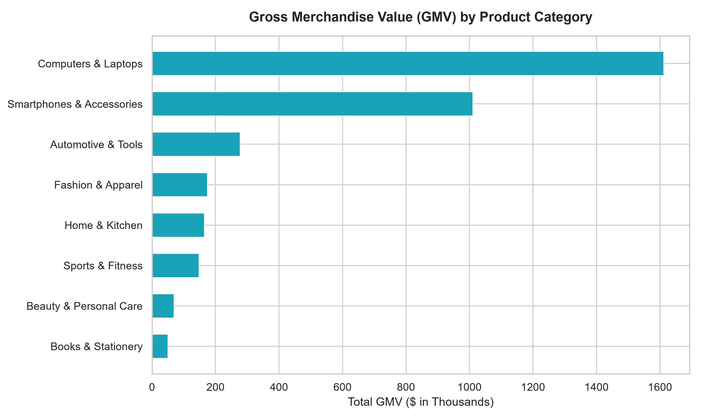

# E-Commerce Customer Lifecycle & Revenue Intelligence System

[](https://pasupuletimahima-ecommerce-customer-revenue-intellig-app-6zblbe.streamlit.app/)
[](https://www.python.org/)
[](https://www.mysql.com/)
[](https://plotly.com/)
[](https://powerbi.microsoft.com/)
[](#-data-architecture-star-schema)

> 🚀 **Live Interactive Web Application:** [**Launch Live Dashboard in Browser**](https://pasupuletimahima-ecommerce-customer-revenue-intellig-app-6zblbe.streamlit.app/) *(Hosted on Streamlit Community Cloud)*

An end-to-end commercial analytics system evaluating **10,408 orders**, **6,000 customers**, and **\$3.51M in Gross Merchandise Value (GMV)**. This project diagnoses customer churn, builds a monthly cohort retention matrix, executes quintile-based RFM customer segmentation, and features a **live interactive Streamlit web dashboard**.

---

## 📌 Executive Summary & Key Metrics

| Metric | Result | Strategic Business Takeaway |
| :--- | :--- | :--- |
| **Total Gross Merchandise Value (GMV)** | **\$3,508,510** | Generated across 10,408 orders (AOV: \$337). |
| **Top Customer Concentration (Champions)** | **35.7% Revenue** | Generated by just 13.8% of customers ($1.21M). |
| **At-Risk Customer Capital** | **\$1,039,178** | Held by 22.4% of customers who haven't ordered in 550+ days. |
| **Month 1 Retention Cliff** | **18.4% Retention** | 81.6% of newly acquired customers drop off within 30 days. |
| **Logistics Satisfaction Impact** | **4.35 ➔ 2.04 Stars** | Delayed orders experience a **1,393% surge** in negative reviews. |

---

## 🏗️ Data Architecture (Star Schema)

The database was structured into an optimized dimensional model (Star Schema) with primary keys, foreign key constraints, and multi-column indexes for fast query performance:



---

## 🔍 Analytical Deep Dives & Visualizations

### 1. Monthly Cohort Retention Matrix
Using SQL Common Table Expressions (CTEs) and date math, we established customer cohorts based on their first purchase month and tracked retention over subsequent months:



```sql
-- Step snippet from sql/02_cohort_retention_analysis.sql
WITH Customer_First_Purchase AS (
    SELECT customer_id, MIN(DATE_FORMAT(order_purchase_timestamp, '%Y-%m-01')) AS cohort_month
    FROM fact_orders
    WHERE order_status = 'delivered'
    GROUP BY customer_id
)
...
```
* **Observation:** Month 1 retention drops precipitously to ~18%, dropping to 4.5% by Month 6.
* **Recommendation:** Implement automated 14-day replenishment drip campaigns to capture second-order conversions before drop-off.

---

### 2. RFM (Recency, Frequency, Monetary) Segmentation
Customers were scored from 1 to 5 across Recency, Frequency, and Monetary dimensions using SQL `NTILE(5)` window functions:



#### Segment Distribution:
| Customer Segment | Total Customers | Share of Users | Segment Revenue | Share of Revenue | Avg Recency |
| :--- | :--- | :--- | :--- | :--- | :--- |
| **1. Champions** | 815 | 13.8% | \$1,215,255 | **35.7%** | 132 days |
| **2. Loyal Customers** | 1,255 | 21.3% | \$900,767 | **26.4%** | 256 days |
| **4. At Risk (Churning)** | 1,320 | 22.4% | \$1,039,178 | **30.5%** | 555 days |
| **5. Hibernating / Lost**| 1,039 | 17.6% | \$103,230 | 3.0% | 563 days |
| **3. Potential Loyalists**| 858 | 14.6% | \$85,706 | 2.5% | 162 days |
| **6. Need Attention** | 609 | 10.3% | \$63,892 | 1.9% | 308 days |

---

### 3. Logistics & Customer Satisfaction Diagnostics
Analyzing fulfillment records against customer review scores:



* **On-Time Deliveries:** 4.35 / 5.0 Average Review Score | 4.7% Negative Reviews (1-2 Stars)
* **Delayed Deliveries:** 2.04 / 5.0 Average Review Score | **70.2% Negative Reviews**
* **Root Cause:** Delays are the single largest predictor of customer dissatisfaction and churn.

---

### 4. Product Category Profitability & Freight Drag



* High-value electronics (Computers, Phones) carry healthy gross profit margins (~42%) and negligible freight drag (<2.5%).
* Lower-ticket categories (Books, Beauty) face shipping costs accounting for 16% to 23% of customer checkout value, warranting bundle packaging.

---

## 🌐 Interactive Web Application Features (`app.py`)

The platform includes a modern **Streamlit Web Application** featuring:
* 🎛️ **Dynamic Multi-Select Filters:** Filter across 8 product categories and 16 states in real time.
* 📈 **Interactive Plotly Visuals:** Area trend lines, payment method donut charts, and category profit bars with hover tooltips.
* 👥 **Cohort Heatmap Explorer:** Zoomable matrix tracking Month 0 through Month 6 retention rates.
* 🔍 **Live Customer Profile Inspector:** Search any customer ID (e.g., `CUST_00142`) to inspect their live RFM score and personalized retention playbook.
* 💡 **What-If Revenue Recovery Simulator:** An interactive slider simulating the exact dollar GMV recovered by reactivating At-Risk buyers.

---

## 📂 Repository Structure

```text
ecommerce_analytics_project/
├── data/
│   ├── raw/                       # Generated raw relational tables
│   └── processed/                 # Validated and cleaned tables
├── sql/
│   ├── 01_schema_setup.sql        # DDL, Star Schema, Primary/Foreign keys & Indexes
│   ├── 02_cohort_retention_analysis.sql # CTE-based Cohort Retention Matrix
│   ├── 03_rfm_customer_segmentation.sql # NTILE(5) RFM Scoring & Business Classification
│   └── 04_logistics_and_satisfaction.sql # Fulfillment SLA & Category Margin Diagnostics
├── scripts/
│   ├── generate_dataset.py        # Generates realistic relational transactions
│   ├── data_cleaning_and_validation.py # Data quality assertions & schema checks
│   ├── run_analytics_pipeline.py  # Standalone SQL engine runner (exports report CSVs)
│   └── generate_charts.py         # Visual chart generation (PNG)
├── app.py                     # Modern interactive web dashboard (Streamlit + Plotly)
├── dashboards/
│   └── POWER_BI_GUIDE.md          # Step-by-step Power BI setup, Star Schema & DAX guide
├── reports/
│   ├── EXECUTIVE_BUSINESS_REPORT.md # C-suite executive briefing with ROI projections
│   └── visualizations/            # Exported chart artifacts
├── requirements.txt           # Python dependencies for dashboard & pipeline
├── .gitignore                 # Excludes Python bytecode and cache
└── README.md
```

---

## 🚀 How to Run Locally

### 1. Clone the repository & Install Dependencies
```bash
git clone https://github.com/pasupuletimahima/ecommerce-customer-revenue-intelligence.git
cd ecommerce-customer-revenue-intelligence
pip install -r requirements.txt
```

### 2. Launch the Interactive Web Dashboard
* 🌐 **Live Cloud Version:** [**Click to Open Live Dashboard**](https://pasupuletimahima-ecommerce-customer-revenue-intellig-app-6zblbe.streamlit.app/) *(Instant access, no installation required)*
* 💻 **Or Run Locally:**
```bash
streamlit run app.py
```
*(Instantly launches the interactive web application with dynamic filters, Plotly charts, customer lookup, and what-if simulation in your browser!)*

### 3. Run the Data Pipeline & SQL Engine (Optional)
```bash
python scripts/generate_dataset.py
python scripts/data_cleaning_and_validation.py
python scripts/run_analytics_pipeline.py
python scripts/generate_charts.py
```

### 4. Open in Power BI (Optional)
Follow the instructions in [`dashboards/POWER_BI_GUIDE.md`](dashboards/POWER_BI_GUIDE.md) to load the cleaned tables, apply the DAX formulas, and view the interactive dashboard.

---

## 📑 Key Project Documents
* [Executive Business Intelligence Report](reports/EXECUTIVE_BUSINESS_REPORT.md)
* [Power BI Step-by-Step Dashboard Setup](dashboards/POWER_BI_GUIDE.md)

---

## 👤 Author
* **Name:** Pasupuleti Mahima
* **Degree:** Master of Computer Applications (MCA)
* **Target Roles:** Data Analyst | Product Analyst | Analytics Engineer
